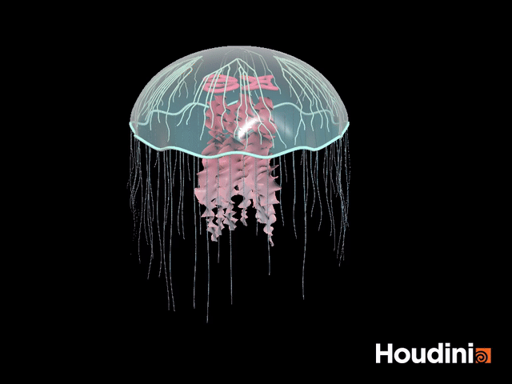
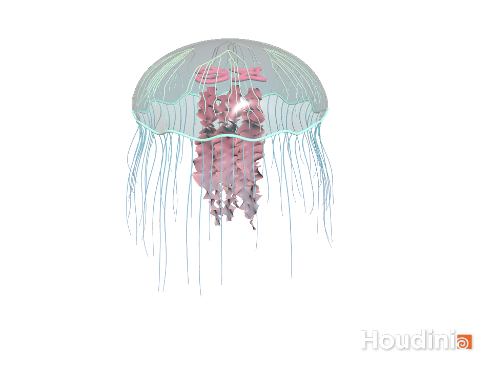

# Luma — Procedural Jellyfish

A stylized jellyfish built in **Houdini 21.0.512 Apprentice** for CIS 5660. A translucent, scalloped bell carries branching veins and four rose-colored internal organs. Six ruffled oral arms move beneath it, surrounded by sixty simulated tentacles.

The animation combines a rhythmic bell contraction, traveling deformation of the oral arms, and Vellum Hair dynamics. The scene contains editable SOP networks, named outputs, a master parameter panel, materials, and a showcase camera.



**[Watch / download the MP4 animation](assets/jellyfish_animation.mp4)** — 6 seconds, 144 frames at 24 fps, 960 × 720.



The preview is rendered with Houdini's OpenGL ROP. The Houdini watermark is produced by the Apprentice license.

## Procedural construction

| Part | Construction | Motion |
| --- | --- | --- |
| Bell | A sampled rotational profile with an open underside, twelve scalloped lobes, shell thickness, and a swept rim | Height-dependent radial contraction and vertical heave |
| Oral arms | Six parametric ribbons with twisting centers, tapered widths, and dense edge ruffles | A separate coarse cage per arm drives the ribbons through Point Deform |
| Veins | Remesh → Find Shortest Path → Fuse → unique graph edges → PolyPath → Resample → Smooth → surface reprojection → Sweep | Point Deform transfers the bell's animation to the resting vein mesh |
| Organs | Four three-lobed tube rings arranged beneath the bell | Follow the bell's heave and a small radial pulse |
| Tentacles | Sixty varied-length curves, 43 simulation points each, followed by resampling and tapered Sweep tubes | Vellum Hair with animated root pins, bending resistance, reduced gravity, drag, and a slowly changing current |

The static bell (`BELL_REST`) and animated bell (`BELL_ANIM`) retain matching topology. Veins are generated on the static surface, so their branching pattern does not change over time. Shared shortest-path edges are consolidated before the branches are smoothed and thickened.

The oral arms use six separate control cages and the `piece` attribute to avoid capturing neighboring arms. Their movement is a procedural deformation; the fine tentacles use an actual dynamics solver.

Scalloped bell edges and the highlighted rim are additional shape refinements. The scene focuses on modeling and animation; it does not include a coral environment or a finished Karma lighting setup.

## Open and inspect the scene

The local scene is **`scenes/Luma_Jellyfish.hipnc`**. It is intentionally ignored by Git and should be submitted to Canvas.

1. Open the `.hipnc` in Houdini 21. The embedded session helper sets the showcase camera and opens the jellyfish network when a Scene View and Network Editor are available.
2. Play frames **1–144**, at **24 fps**. The default uses the simulation embedded in the scene, so the HIP can be moved without copying the disk cache.
3. Enter **`/obj/JELLYFISH`** and select **`CONTROLS`**, then open its **Spare** parameter tab. The colored network boxes identify the five assignment parts.
4. Use **Display Part** to inspect Bell, Oral Arms, Veins, Organs, or Tentacles separately.
5. To reproduce the preview, render **`/out/VIEWPORT_PREVIEW`**. Its default image destination is `$HIP/../work/preview/jellyfish.$F4.png`.

If a current Houdini desktop does not apply the camera automatically, select **SHOWCASE_CAMERA** from the Scene View camera menu. Use headlight lighting for a look matching the preview.

## Main parameters

| Control | Default | Effect |
| --- | ---: | --- |
| Bell Radius / Height | 2.05 / 1.38 | Bell proportions |
| Rim Lobes / Scalloped Rim Depth | 12 / 0.075 | The repeating edge shape |
| Contraction Amount | 0.105 | Strength of the swimming pulse |
| Pulse Period | 2.8 seconds | Duration of one bell contraction cycle |
| Vertical Swim Motion | 0.12 | Vertical heave |
| Oral Arms / Arm Length | 6 / 3.2 | Number and nominal length of the ruffled ribbons |
| Oral Arm Half Width | 0.27 | Width of the oral-arm ribbons |
| Tentacle Count / Length | 60 / 2.65 | Number and nominal length of fine tentacles |
| Water Current Strength | 0.22 | Lateral forcing in the Vellum solver |
| Vein Radius | 0.011 | Base radius of the swept vein tubes |
| Use Saved Tentacle Cache | On | Switch between the embedded bake and live Vellum |

**Before changing geometry, timing, or simulation parameters, turn off Use Saved Tentacle Cache and return to frame 1.** Play forward to recompute the live solver. The saved cache represents the original settings and will not update itself when parameters change. Rebuild the cache after approving the new motion.

The embedded cache covers frames 1–144. Outside this range the cached tentacles hold the nearest end frame; extend and rebake the simulation for a longer animation. The six-second preview is a continuous simulation excerpt, not a seamless loop.

For fast iteration, tentacle self-collision and collisions against the other jellyfish parts are not configured. Occasional strand crossings are possible. This is a stylized reduced-gravity hair simulation, not a fluid simulation.

## Rebuild from source

All required geometry code is embedded in the HIP. The Python scripts are also provided to make the construction inspectable and reproducible. No external HDAs or downloaded model assets are required.

Run these from the repository directory using Houdini's Python executable:

```powershell
$hython = 'C:\Program Files\Side Effects Software\Houdini 21.0.512\bin\hython.exe'
& $hython scripts\build_jellyfish.py
& $hython scripts\cache_and_preview.py --frames 144
& $hython scripts\finalize_and_render.py --render
```

`build_jellyfish.py` regenerates and overwrites the generated scene. Save a differently named copy before rebuilding if you have made manual changes.

`cache_and_preview.py` simulates the curves, writes optional `.bgeo.sc` files under `cache/tentacles/`, checks moving-root attachment, and embeds compact packed simulation frames in a Stash SOP. `finalize_and_render.py` checks the complete model over the animation and optionally renders its PNG sequence.

With FFmpeg available, encode the sequence as:

```powershell
ffmpeg -framerate 24 -start_number 1 -i work/preview/jellyfish.%04d.png -frames:v 144 -c:v libx264 -crf 18 -pix_fmt yuv420p -movflags +faststart assets/jellyfish_animation.mp4
```

The local validation checked all 144 frames for nonempty geometry and finite positions. Sampled simulation frames checked that the roots moved and matched their animated targets. Each part's output cooked without node errors.

## 中文：节点结构与修改方法

这份工程把“模型如何生成”和“模型如何运动”分开，方便逐部分学习。

- **先看 `CONTROLS` 的 Spare 页签。** 这里集中控制尺寸、收缩节奏、口腕数量和触手长度。Display Part 可以单独显示某一个部件。
- **伞体分为 REST 和 ANIM。** `bell_profile_surface` 用 VEX 创建规则的钟形表面；`bell_swimming_pulse` 让边缘比顶部收缩得更多。静止分支始终保留，用来生成血管和传递形变。
- **血管使用作业指定方法。** `triangulate_bell_for_veins` 把伞体重网格成三角形；`vein_start_and_end_points` 提供六个起点和六十个终点；`branching_shortest_paths` 沿网格寻找路径。后续节点去掉重叠边、整理分支、平滑并投射回伞体，再用 Sweep 变成细管。
- **Point Deform 的三个输入有固定含义。** 第一个是要变形的细节模型，第二个是静止控制网格，第三个是运动控制网格。血管使用伞体作为控制网格；口腕使用各自的低精度笼子。
- **口腕不是细触手。** `ruffled_oral_arm_ribbons` 生成中央六条宽带。沿长度扭转、在边缘加入高频波纹，形成褶皱；低精度笼子的波动再传递给完整模型。
- **细触手是真实 Vellum 模拟。** `tentacle_rest_curves` 生成外围曲线并标记 `roots`；`animated_tentacle_targets` 更新根部目标；`vellum_configure_hair` 设置伸长、弯曲与根部约束；`VELLUM_TENTACLE_SIM` 求解摆动。最后才增加曲线采样密度和管状厚度。
- **缓存用于直接播放。** `EMBEDDED_TENTACLE_CACHE` 保存全部模拟帧；`SELECT_CACHED_FRAME` 按当前时间选帧，`UNPACK_CACHED_CURVES` 取出曲线。修改形状或动画前必须关闭缓存，否则触手仍会播放旧结果。

大多数节点可直接修改参数；以 Attribute Wrangle 实现的生成节点可在 VEXpression 中检查和修改代码。当前外形是依据作业文字与参考图独立实现的版本，并非教学视频节点网络的逐一复刻。

## References and attribution

- [Course bell tutorial](https://www.youtube.com/watch?v=J3X8BB0yNRE)
- [Course oral-arm tutorial](https://www.youtube.com/watch?v=A_oNXqx8XH4)
- [Hair simulation reference supplied by the assignment](https://www.youtube.com/watch?v=LN4XXaHQkmU)
- [SideFX — Find Shortest Path](https://www.sidefx.com/docs/houdini/nodes/sop/findshortestpath.html)
- [SideFX — Point Deform](https://www.sidefx.com/docs/houdini/nodes/sop/pointdeform.html)
- [SideFX — Vellum Constraints](https://www.sidefx.com/docs/houdini/nodes/sop/vellumconstraints.html)

The course README and reference images informed the required parts and the vein workflow. The bell and arm generators are independent implementations. The implementation and build scripts were prepared with Codex assistance.

## Submission status

- Local Houdini scene, animation, preview images, and project description prepared.
- Houdini scenes and simulation caches are excluded from Git, as requested by the assignment.
- The scene should be reviewed and personalized before submission.
- Creating/publishing the GitHub pull request and submitting the HIP plus PR link to Canvas remain to be done.
